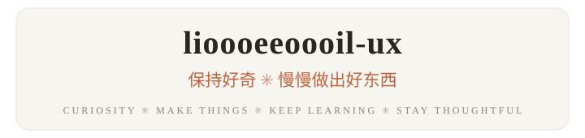

  <picture>
    <source media="(prefers-color-scheme: dark)" srcset="assets/banner-dark.svg">
    
  </picture>

  

  <samp>
    <a href="https://lioooeeoooil-ux.github.io/liooeeooil-ux/">个人主页</a> &nbsp;·&nbsp;
    <a href="https://github.com/lioooeeoooil-ux/human-ai-writing">Human-AI Writing</a> &nbsp;·&nbsp;
    <a href="https://github.com/lioooeeoooil-ux?tab=repositories">更多项目</a>
  </samp>

---

**✳ 正在做的事**

- **[human-ai-writing](https://github.com/lioooeeoooil-ux/human-ai-writing)** — 探索人和 AI 如何协作完成长篇技术分析的写作系统 · `Python`
- **[个人主页](https://github.com/lioooeeoooil-ux/liooeeooil-ux)** — 持续更新的个人网站，记录项目与一路上的思考 · `HTML` `GitHub Pages`

**✳ 我在意的事**

`持续学习` `创造与分享` `探索新想法` `认真生活`

  <samp>✳ 有个好点子？<a href="https://lioooeeoooil-ux.github.io/liooeeooil-ux/">来我的主页坐坐</a> ✳</samp>

